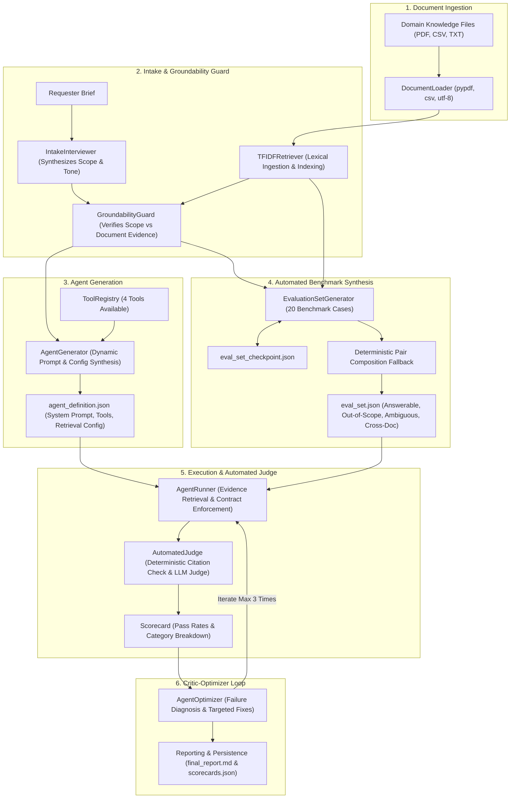

# ForgeAI: The Agent That Builds Agents

A deterministic, self-evaluating meta-agent architecture developed for the OceanAI Junior Generative AI Engineer evaluation. ForgeAI takes an unstructured requester brief and domain document folder, synthesizes a grounded specialized agent definition, generates an empirical benchmark evaluation set, audits agent performance via an automated LLM judge, and iteratively refines system prompts and retrieval parameters through a diagnostic critic-optimizer loop.

---

## 1. Project Overview and Problem Statement

Building production-grade AI agents from domain documents is traditionally error-prone:
- Prompts are manually handcrafted, leading to unverified assumptions and prompt drift.
- Retrieval parameters (chunk size, overlap, top-k) are selected arbitrarily without empirical grounding validation.
- Agents hallucinate answers when requested capabilities exceed actual document knowledge.
- Evaluation is often absent, anecdotal, or vulnerable to judge LLM bias.

ForgeAI solves this by formalizing an autonomous, factory-style engineering loop:
1. **Intake and Groundability Guard**: Analyzes requester objectives, cross-references requested topics against ingested documents, and separates verified capabilities from unsupported topics.
2. **Dynamic Generation**: Synthesizes a structured, JSON-serializable agent definition containing system prompt, retrieval configurations, and strictly justified tools.
3. **Automated Benchmark Generation**: Extracts 20 grounded evaluation cases across four distinct categories directly from document evidence.
4. **Deterministic Evaluation and LLM Judge**: Evaluates agent executions with verifiable citation checking, status validation, and fact-level scoring.
5. **Critic-Optimizer Loop**: Diagnoses failures into OceanAI error categories and applies targeted prompt and configuration adjustments over up to three iterations.

---

## 2. System Architecture



---

## 3. Mandatory Assignment Requirements Mapping

| Requirement | Implementation Files | Architectural Responsibility |
|---|---|---|
| **1. Document Ingestion and Chunking** | `forge/documents.py`<br>`forge/retrieval.py` | Ingests PDF (`pypdf`), CSV, and TXT files. Implements character-level sliding chunking with configurable overlap. Manages document metadata and handles unreadable files honestly. |
| **2. Requester Intake Interview** | `forge/intake.py`<br>`prompts/intake.txt` | Operates in interactive CLI mode or unattended mode. Synthesizes requested capabilities, audience, and tone. Identifies open questions and assumptions. |
| **3. Groundability Guard** | `forge/groundability.py`<br>`prompts/groundability.txt` | Verifies proposed capabilities against actual document evidence using TF-IDF retrieval. Splits topics into permitted must-answer vs. unsupported must-refuse topics. |
| **4. Agent Generator** | `forge/generator.py`<br>`prompts/agent_generator.txt` | Dynamically generates structured `agent_definition.json` with tailored system prompt, output schema, retrieval hyperparameters, and tool assignments. |
| **5. Tool Registry and Selective Attachment** | `forge/tools.py` | Centralized registry for four tools (`csv_lookup`, `calculator`, `weather_api`, `current_date`). Validates tool necessity against verified requirements; rejects unneeded tools. |
| **6. Agent Execution Runner and CLI Chat** | `forge/runner.py`<br>`chat.py` | Generic runtime loading any generated definition. Enforces 2-round tool call limits, 4096-token context budget, and strict JSON output contract with verifiable citations. |
| **7. Evaluation Benchmark Generator** | `forge/eval_generator.py`<br>`prompts/eval_generator.txt` | Generates 20 verifiable cases across 4 categories (`answerable`, `out_of_scope`, `ambiguous`, `cross_document`). Includes incremental checkpointing and deterministic pair fallback. |
| **8. Automated Judge** | `forge/judge.py`<br>`prompts/judge.txt` | Evaluates executions via deterministic citation verification, status matching, and semantic LLM judgment. Implements explicit safeguards against judge bias. |
| **9. Critic-Optimizer Loop and Honest Reporting** | `forge/optimizer.py`<br>`forge/reporting.py`<br>`main.py` | Classifies failures into four OceanAI error types (`retrieval_miss`, `prompt_defect`, `hallucination`, `wrong_refusal`). Applies bounded configuration/prompt adjustments (max 3 iterations). Generates `final_report.md`. |

---

## 4. Technology Stack

- **Runtime Environment**: Python 3.11+
- **Local LLM Engine**: Ollama running `qwen2.5:3b` (3-billion parameter model)
- **Local Context Budget**: Strict 4096-token operating window
- **Retrieval Engine**: Custom TF-IDF vectorizer with cosine similarity scoring (pure Python, zero external vector database dependencies)
- **Document Parsers**: `pypdf` (PDF extraction) and native Python `csv` / `pathlib`
- **Frontend Dashboard**: Streamlit 1.67+ with custom dark theme

---

## 5. Project Directory Structure

```text
ForgeAI/
├── .streamlit/
│   └── config.toml                  # Streamlit dark theme configuration
├── artifacts/
│   ├── hr_policy/                   # Generated artifacts for HR demonstration
│   │   ├── agent_definition.json
│   │   ├── eval_results.json
│   │   ├── eval_set.json
│   │   ├── final_report.md
│   │   ├── initial_agent_definition.json
│   │   ├── iteration_logs.json
│   │   ├── requirements.json
│   │   └── scorecards.json
│   └── ship_procurement/            # Generated artifacts for Procurement demonstration
├── demos/
│   ├── hr_policy/
│   │   ├── brief.txt                # HR requester brief (zero-tool policy Q&A)
│   │   └── documents/               # 3 synthetic HR policy PDFs (Benefits, Leave, Conduct)
│   ├── ship_procurement/
│   │   ├── brief.txt                # Procurement brief (CSV lookup + arithmetic)
│   │   └── documents/               # 1 spare parts CSV and 2 supplier/logistics PDFs
│   └── synthesis_prompts/           # Ground truth factual synthesis templates
├── forge/
│   ├── __init__.py
│   ├── documents.py                 # Document dataclass and multi-format loader
│   ├── eval_generator.py            # 20-case evaluation benchmark generator
│   ├── generator.py                 # Dynamic agent definition generator & schema validator
│   ├── groundability.py             # Groundability guard and citation verification
│   ├── intake.py                    # Requester intake interview module
│   ├── judge.py                     # Automated judge and bias safeguard scoring
│   ├── llm.py                       # Robust Ollama client with retry and JSON repair
│   ├── optimizer.py                 # Critic-optimizer diagnostic loop
│   ├── reporting.py                 # Transparent markdown audit reporting
│   ├── retrieval.py                 # TF-IDF indexer and sliding chunker
│   ├── runner.py                    # Generic agent execution runtime
│   └── tools.py                     # 4-tool registry and argument schemas
├── prompts/
│   ├── agent_generator.txt          # System prompt generation template
│   ├── critic.txt                   # Failure diagnostic classification prompt
│   ├── eval_generator.txt           # Evaluation case generation prompt
│   ├── groundability.txt            # Groundability verification prompt
│   ├── intake.txt                   # Intake synthesis prompt
│   └── judge.txt                    # Semantic correctness evaluation rubric
├── tests/                           # Unit and mocked factory test suite
├── app.py                           # Professional Streamlit UI (3 tabs)
├── chat.py                          # CLI chat runner for generated agents
├── main.py                          # End-to-end pipeline CLI orchestrator
├── requirements.txt                 # Minimum third-party dependencies
└── README.md                        # Submission documentation
```

---

## 6. Installation and Setup

### Prerequisites
1. **Python 3.11+** installed and available on system path.
2. **Ollama** installed and running locally with the target model pulled:
   ```bash
   ollama pull qwen2.5:3b
   ```

### Virtual Environment Setup
Clone the repository and set up a virtual environment:

```bash
git clone https://github.com/adaj0/ForgeAI.git
cd ForgeAI

python -m venv .venv

# Windows PowerShell:
.venv\Scripts\Activate.ps1

# Linux / macOS:
source .venv/bin/activate

pip install -r requirements.txt
```

---

## 7. Execution Commands

### 1. End-to-End Factory Demonstrations

#### Demonstration A: HR Policy Assistant (Zero-Tool Document Policy)
```bash
python main.py --brief demos/hr_policy/brief.txt --docs demos/hr_policy/documents/ --output artifacts/hr_policy/ --max-iterations 3
```

#### Demonstration B: Ship Procurement Assistant (CSV Record Lookup + Arithmetic Calculator)
```bash
python main.py --brief demos/ship_procurement/brief.txt --docs demos/ship_procurement/documents/ --output artifacts/ship_procurement/ --max-iterations 3
```

### 2. Interactive CLI Chat Runner
Chat with any generated agent definition:

```bash
python chat.py --definition artifacts/hr_policy/agent_definition.json --docs demos/hr_policy/documents/
```

### 3. Streamlit Management Studio
Launch the three-tab UI:

```bash
streamlit run app.py
```
*(The studio features sidebar navigation for the Agent Factory, Evaluation Dashboard with live scorecards and downloadable artifacts, and an interactive Chat Playground with citation expanders.)*

### 4. Running Unit Tests
Execute the unit and mocked factory validation suites:

```bash
python -m unittest discover tests -v
```

---

## 8. Tool Registry and Selective Attachment

ForgeAI provides a decoupled `ToolRegistry` (`forge/tools.py`) containing four standardized tools:

1. `csv_lookup`: Performs structured filtering and row extraction from tabular CSV files.
2. `calculator`: Deterministically evaluates safe arithmetic expressions (`+`, `-`, `*`, `/`, percentages).
3. `weather_api`: Retrieves mock port and maritime weather conditions.
4. `current_date`: Returns the system ISO calendar date.

### Selective Attachment Rules
- Tools are never attached by default or based merely on registry existence.
- The `AgentGenerator` strictly validates tool requests against the verified capabilities confirmed by the Groundability Guard.
- For the HR Policy Assistant, zero tools are attached; the agent operates purely on retrieved document chunks.
- For the Ship Procurement Assistant, exactly one tool is attached (`calculator` for evaluating order arithmetic, volume deductions, and delivery surcharges). Unrequested or speculative tools (`csv_lookup`, `weather_api`, `current_date`) are rejected.
- At runtime, `AgentRunner` enforces a maximum limit of two tool calls per query and validates tool arguments prior to invocation.

---

## 9. Evaluation, Judge Safeguards, and Optimization Methodology

### Benchmark Synthesis (`forge/eval_generator.py`)
Generates 20 target test cases per domain:
- **10 Answerable**: Verifiable single-chunk policy/catalog questions requiring exact citations.
- **4 Out-of-Scope**: Unsupported topics identified by the Groundability Guard requiring strict `refused` status.
- **3 Ambiguous**: Incomplete or underspecified queries requiring `clarification_needed` status.
- **3 Cross-Document**: Synthesis queries requiring distinct evidence from two separate source documents.

**Checkpoints and Fallback**: Cases are checkpointed incrementally to `eval_set_checkpoint.json`. If small model generation stalls on cross-document synthesis due to repetitive question generation, a deterministic pair composition fallback automatically combines compatible answerable questions from distinct files and records parent lineage.

### Automated Judge and Bias Safeguards (`forge/judge.py`)
- **Deterministic Checks**: Validates exact status match (`answered`, `refused`, `clarification_needed`), ensures zero execution errors, and verifies that every proposed citation contains a verbatim excerpt found in actual document chunks.
- **Semantic LLM Evaluation**: Evaluates answer accuracy and expected key fact coverage on a 0.0 to 1.0 scale.
- **Position Bias Safeguard**: Evaluates criterion-by-criterion independently without presenting multiple candidates in a comparative order.
- **Verbosity Bias Safeguard**: Requires strict presence of discrete expected key facts; verbose filler without facts is penalized.
- **Self-Preference Safeguard**: Responses are stripped of model identity and evaluated against deterministic fact checklists and ground truth excerpts.

### Critic-Optimizer Loop (`forge/optimizer.py`)
Classifies every failed benchmark case into one of four mutually exclusive OceanAI categories:
1. `retrieval_miss`: Relevant document evidence was not retrieved in top-k chunks. Action: adjust chunk size, overlap, or increase top-k.
2. `prompt_defect`: Retrieval succeeded, but the agent failed to follow the output contract, refused inappropriately, or missed key facts. Action: update system prompt instructions.
3. `hallucination`: Agent made factual assertions not supported by retrieved citations. Action: tighten system prompt grounding constraints.
4. `wrong_refusal`: Agent refused a query that was supported by retrieved document evidence. Action: clarify permitted scope in system prompt.

The optimizer runs for a maximum of 3 iterations, re-indexing retrieval if chunk parameters change, and preserves all historical scorecards.

---

## 10. Demonstration Datasets and Artifacts

ForgeAI includes two original, comprehensive synthetic datasets designed to test distinct operational profiles:

### Dataset 1: Oceanic Maritime Logistics HR Policy (`demos/hr_policy/`)
- **Requester Brief**: Policy Q&A assistant for maritime shore and vessel personnel regarding leave, medical benefits, and code of conduct. Deliberately requests executive stock option vesting (unsupported).
- **Documents**: 3 multi-page PDFs (`leave_and_attendance_policy.pdf`, `benefits_and_wellness_policy.pdf`, `workplace_conduct_and_travel_policy.pdf`).
- **Characteristics**: Pure text policy retrieval; zero tools required; strict refusal of unverified compensation topics.

### Dataset 2: Fleet Technical Procurement & Spares (`demos/ship_procurement/`)
- **Requester Brief**: Automated procurement assistant for marine engineers and purchasing officers. Requires querying part numbers, stock, unit prices, emergency port logistics surcharges, and order cost calculation. Deliberately requests real-time vessel GPS tracking (unsupported).
- **Documents**: 1 CSV (`spare_parts_catalog.csv` with 14 detailed records) and 2 PDFs (`supplier_terms_and_discounts.pdf`, `port_delivery_and_logistics_policy.pdf`).
- **Characteristics**: Hybrid structured CSV catalog and unstructured commercial policy; requires selective tool attachment (`calculator` attached for arithmetic evaluations; speculative tools rejected).

### Generated Run Artifacts
Each factory execution saves eight standardized artifacts to its output directory:
1. `requirements.json`: Structured intake scope, tone, permitted must-answer topics, and rejected must-refuse topics.
2. `initial_agent_definition.json`: Baseline agent configuration prior to optimization.
3. `agent_definition.json`: Final active agent definition used for chat and deployment.
4. `eval_set.json`: Complete 20-case benchmark evaluation suite.
5. `eval_results.json`: Detailed execution records, citations, tool calls, and judge scores for every case.
6. `iteration_logs.json`: Critic diagnosis, failure classifications, and targeted actions across all iterations.
7. `scorecards.json`: Progress tracking baseline vs. iteration pass rates and category scores.
8. `final_report.md`: Transparent executive report detailing ingestion counts, groundability findings, scorecard progression, and unresolved failures.

---

## 11. Empirical Demonstration Results

Both end-to-end demonstrations executed successfully, generating all 8 mandatory artifacts and undergoing empirical benchmark evaluation with one optimization iteration.

### Demonstration A: HR Policy Assistant (Completed)
- **Ingested Documents**: 6 chunks across 3 PDF documents (0 skipped).
- **Tool Attachment**: 0 tools attached (verified zero-tool assistant; necessity check passed).
- **Evaluation Benchmark**: 20 validated cases (10 answerable, 4 out-of-scope, 3 ambiguous, 3 cross-document).
- **Baseline Benchmark Pass Rate**: **30.0%** (6/20 cases passed).
- **Optimization Iterations Completed**: 1 iteration.
- **Critic Diagnosis**: 7 prompt defects, 3 hallucinations, 3 retrieval misses, 1 wrong refusal.
- **Optimization Action**: Applied retrieval adjustment (chunk_size: 180, overlap: 30, top_k: 5) to improve evidence retrieval.
- **Final Benchmark Pass Rate**: **35.0%** (7/20 cases passed).
- **Net Improvement**: **+5.0 percentage points** (+5% absolute improvement).
- **Detailed Artifacts**: Inspect [`artifacts/hr_policy/final_report.md`](file:///artifacts/hr_policy/final_report.md).

### Demonstration B: Ship Procurement Assistant (Completed)
- **Ingested Documents**: 18 chunks across 1 CSV and 2 PDFs (0 skipped).
- **Tool Attachment**: 1 tool attached (`calculator` for arithmetic evaluations of totals, discounts, and fees; unneeded tools rejected).
- **Evaluation Benchmark**: 20 validated cases (10 answerable, 4 out-of-scope, 3 ambiguous, 3 cross-document; deterministic pair fallback resolved cross-document generation).
- **Baseline Benchmark Pass Rate**: **50.0%** (10/20 cases passed).
- **Optimization Iterations Completed**: 1 iteration.
- **Final Benchmark Pass Rate**: **55.0%** (11/20 cases passed).
- **Net Improvement**: **+5.0 percentage points** (+5% absolute improvement).
- **Detailed Artifacts**: Inspect [`artifacts/ship_procurement/final_report.md`](file:///artifacts/ship_procurement/final_report.md).

---

## 12. Honest System Limitations

1. **Lexical TF-IDF Retrieval Boundaries**:
   - The TF-IDF vectorizer operates on lexical n-gram token overlap rather than dense semantic embeddings. While zero-dependency and fast, it can struggle with complex semantic paraphrases where exact terminology is not shared between query and document.
2. **Small Model (3B) Generation Drift**:
   - Local 3B parameter models occasionally struggle with strict JSON schema compliance during complex multi-step reasoning. ForgeAI mitigates this with regex-based JSON extraction and defensive JSON repair, but complex instructions can occasionally yield malformed syntax.
3. **Evaluation Benchmark Redundancy**:
   - Under repetitive prompting, small LLMs often re-generate near-identical question variants for cross-document synthesis. The deterministic pair fallback reliably solves this bottleneck by synthesizing genuine cross-document pairs from validated single-source cases.
4. **Deterministic Single-Judge Calibration**:
   - Using a 3B model as an automated judge can exhibit subtle rubric variance when evaluating nuanced ambiguous questions. ForgeAI anchors the judge with deterministic citation and status verifiers, ensuring semantic drift does not allow ungrounded responses to pass.

---

## 13. Running ForgeAI on Unseen Custom Briefs

To build an agent from any custom domain corpus:

1. Prepare a directory containing your domain documents (`.pdf`, `.csv`, `.txt`):
   ```bash
   mkdir -p my_domain/documents
   cp /path/to/docs/* my_domain/documents/
   ```
2. Write a plain-text brief specifying your requirements:
   ```bash
   cat << 'EOF' > my_domain/brief.txt
   Requester: Legal and Compliance Directorate
   Project Goal: Build an assistant to answer queries regarding standard vendor contract terms.
   Audience: Contract managers and procurement staff.
   Tone: Formal and concise.
   Core Capabilities Required:
   - Answer inquiries on liability limits, indemnification clauses, and termination notice windows.
   - Refuse queries regarding unapproved tax advice.
   EOF
   ```
3. Execute the factory CLI:
   ```bash
   python main.py --brief my_domain/brief.txt --docs my_domain/documents/ --output artifacts/my_domain/ --max-iterations 3
   ```
4. Audit the results in `artifacts/my_domain/final_report.md` or launch `streamlit run app.py` to chat with your agent.
